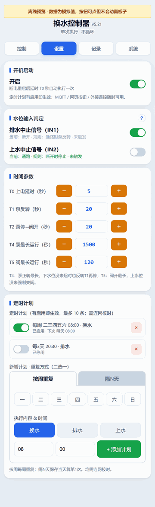
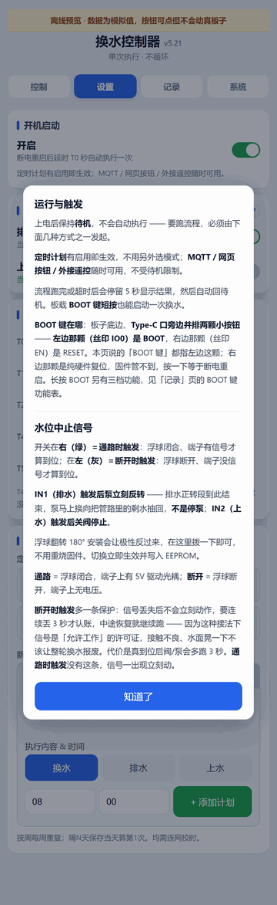
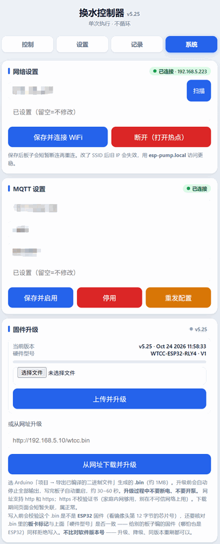
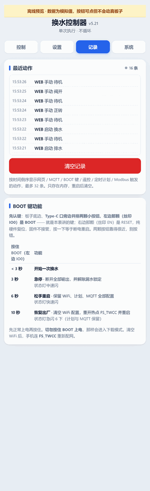

# WTCC 换水控制器固件

基于 ESP32 的鱼缸换水控制器固件，硬件平台为 **WTCC-ESP32-RLY4-V1**（四路继电器 + 四路光耦输入）。本固件将成品板原厂 Modbus 从机功能与换水控制器逻辑合并，支持网页控制、MQTT、Home Assistant 自动发现，以及单键遥控（光耦#4/IN4：1 击排水、2 击上水、3 击换水、长按急停）。

当前版本：**v5.25**

## 软件界面

<table>
  <tr>
    <td align="center"><b>控制页</b><br></td>
    <td align="center"><b>设置页</b><br></td>
  </tr>
  <tr>
    <td align="center"><b>信息页</b><br></td>
    <td align="center"><b>系统页</b><br></td>
  </tr>
  <tr>
    <td align="center" colspan="2"><b>日志页</b><br></td>
  </tr>
</table>

## 目录结构

```
WTCC/
├── WTCC_firmware/
│   └── WTCC_firmware.ino    # 固件源码
├── .github/                 # GitHub Actions 云编译配置
└── docs/screenshots/        # 软件界面截图
```

## 编译与烧录

固件使用 Arduino IDE 编译，目标芯片为 ESP32。仓库已配置 GitHub Actions 云编译，可直接在 Actions 中产出固件，也可本地编译后烧录。

烧录方式：
- **OTA 无线烧录**：设备联网后在 Arduino IDE 端口列表中会显示 `WTCC at 192.168.x.x`。
- **串口烧录**：全片合并固件见 `_bin/` 目录（未纳入版本库）。

## 版本历史

| 版本 | 说明 |
|---|---|
| v5.25 | 修 HA 实体全消失（报文少一个 `}`）；恢复出厂设置为真全清；BOOT 键表三列 |
| v5.24 | 修「下次执行时间」指向过去 |
| v5.23 | 事件日志时间改成真实时钟 |
| v5.22 | 修 HA 发现报文超 256 字节发不出去（v5.21 回归） |
| v5.21 | 固件源码 + GitHub Actions 云编译配置 |
